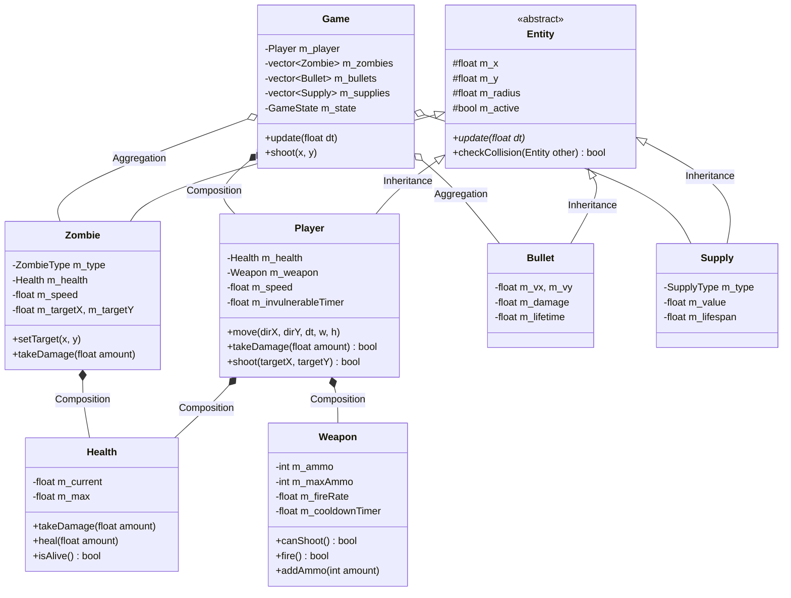

# 🧟 Zombie Survival 2D — C++ OOP & WebAssembly Arena

A high-performance 2D top-down zombie survival arena game designed for college coursework, viva presentations, and web deployment. The project demonstrates core **Object-Oriented Programming (OOP)** principles in **C++17**, compiled to **WebAssembly (WASM)** via Emscripten, and rendered smoothly using HTML5 Canvas and the Web Audio API.

---

## 📋 Table of Contents
1. [Project Overview](#-project-overview)
2. [Key Features](#-key-features)
3. [Technology Stack](#-technology-stack)
4. [Project Structure](#-project-structure)
5. [C++ OOP Architecture Guide](#-c-oop-architecture-guide)
   - [Encapsulation](#1-encapsulation)
   - [Inheritance](#2-inheritance)
   - [Polymorphism](#3-polymorphism)
   - [Composition](#4-composition)
6. [Why WebAssembly (WASM)?](#-why-webassembly-wasm)
7. [Installation & Local Setup](#-installation--local-setup)
8. [Compiling C++ to WebAssembly with Emscripten](#-compiling-c-to-webassembly-with-emscripten)
9. [Deployment to Vercel](#-deployment-to-vercel)
10. [Game Controls & Mechanics](#-game-controls--mechanics)
11. [5 Likely College Viva Questions & Answers](#-5-likely-college-viva-questions--answers)

---

## 🎯 Project Overview

In **Zombie Survival**, the player takes control of an elite survivor inside a fortified outpost. Relentless waves of infected mutants spawn around the arena perimeter and chase the player. The survivor must aim, shoot, manage limited ammunition, collect medical kits and ammo crates, and survive increasingly intense waves to achieve the highest score.

The game is structured with an intentional dual-engine architecture:
- **Core C++ Simulation Engine (`cpp/`)**: All movement, vectors, collision detection, health invariants, weapon cooldowns, wave algorithms, and scoring are written in strict modern C++17 OOP.
- **Web Frontend (`public/`)**: Canvas procedural renderer, lighting cones, particle effects, directional audio synthesizer, responsive touch joystick, and modal UI.
- **Deployment-Ready JS Mirror (`cpp-fallback-engine.js`)**: A 1:1 JavaScript implementation of the exact same C++ class structure. This guarantees that students can run, demo, and deploy the project on Vercel immediately, even before compiling via the Emscripten SDK.

---

## ✨ Key Features

- **Object-Oriented Architecture**: Clean C++ classes implementing Encapsulation, Inheritance, Polymorphism, and Composition.
- **Wave Progression System**: Dynamically scales zombie count, speed, and health as waves advance.
- **Multiple Zombie Types**:
  - *Normal Zombie*: Balanced speed and health.
  - *Runner Zombie*: High speed, agile, lower health.
  - *Tank Zombie*: Heavy health, armored, high contact damage.
- **Supply Drop System**: Health kits and Ammo crates spawn periodically at safe coordinates.
- **Invulnerability Frames (i-frames)**: Brief damage immunity with visual blinking after being hit to prevent instant repeated damage.
- **Zero-Dependency Procedural Audio**: Gunshots, zombie groans, hit impacts, and wave sirens synthesized natively via the Web Audio API without needing external MP3/WAV files.
- **Visual Polish**: Flashlight cone, dynamic crosshairs, screen shake, blood splatters, bullet sparks, and floating combat text (`+100`, `+30 HP`, `EMPTY!`).
- **Interactive In-Game Viva Guide**: An on-screen modal accessible from the main menu and pause screen explaining all OOP concepts and viva questions for quick student reference during presentations!
- **Persistent High Scores**: Best score and survival time tracked in browser `localStorage`.
- **Mobile Friendly**: Auto-detects touchscreens and renders a virtual joystick and fire button.

---

## 🛠️ Technology Stack

| Layer | Technology | Role |
|---|---|---|
| **Simulation Core** | C++17 | Entity physics, circle collisions, wave logic, state machines |
| **Compiler / Bridge** | Emscripten (`emcc`) | Compiles C++ to WebAssembly (.wasm) and generates JS glue code |
| **Renderer** | HTML5 Canvas & Vanilla JS | 60 FPS procedural 2D rendering, camera tracking, particle effects |
| **Interface & Styling** | HTML5 + Vanilla CSS3 | Dark post-apocalyptic HUD, Orbitron & Outfit typography, modals |
| **Audio** | Web Audio API | Zero-asset procedural real-time retro sound synthesis |
| **Deployment** | Vercel Static Hosting | Production deployment without requiring background servers |

---

## 📁 Project Structure

```text
zombie-survival/
├── cpp/                           # Core C++17 Object-Oriented Simulation
│   ├── Entity.h / .cpp           # Abstract base class (Position, radius, update)
│   ├── Health.h / .cpp           # Encapsulated health invariants (0 <= hp <= max)
│   ├── Weapon.h / .cpp           # Composed weapon system (Ammo, fire rate, cooldown)
│   ├── Bullet.h / .cpp           # Ballistic projectile derived from Entity
│   ├── Supply.h / .cpp           # Health and Ammo collectible crates
│   ├── Zombie.h / .cpp           # AI chasers (Normal, Runner, Tank)
│   ├── Player.h / .cpp           # Survivor composing Health & Weapon
│   ├── Game.h / .cpp             # Master game controller & state machine
│   └── bindings.cpp              # Emscripten Embind & C-linkage export interface
├── public/                        # Web Frontend & Deployment Assets
│   ├── index.html                # Main UI, HUD overlay, modals, and Canvas
│   ├── styles.css                # Dark military-charcoal aesthetic & glassmorphism
│   ├── game.js                   # Canvas renderer, audio synth, input controller
│   ├── cpp-fallback-engine.js    # 1:1 JavaScript mirror of the C++ OOP classes
│   └── assets/                   # Optional media directory
├── dist/                          # Production build output generated by npm run build
├── scripts/
│   └── build.js                  # Static packaging script
├── build_wasm.ps1                 # Windows PowerShell Emscripten compilation script
├── build_wasm.sh                  # macOS / Linux Emscripten compilation script
├── CMakeLists.txt                 # CMake configuration for native or WASM compilation
├── server.js                      # Zero-dependency local development HTTP server
├── package.json                   # Project scripts and metadata
├── vercel.json                    # Vercel deployment and WASM MIME headers configuration
└── README.md                      # Complete academic and technical documentation
```

---

## 🧠 C++ OOP Architecture Guide

The project is structured to make explaining OOP concepts straightforward during a 5–10 minute evaluation.



### 1. Encapsulation
- **Health Component (`cpp/Health.h`)**:
  `m_current` and `m_max` are strictly `private`. External code cannot assign arbitrary values. Mutations must pass through `takeDamage(amount)` or `heal(amount)`, guaranteeing the mathematical invariant:
  $$0 \le m\_current \le m\_max$$
- **Weapon System (`cpp/Weapon.h`)**:
  `m_ammo` is protected from becoming negative. The cooldown timer prevents firing faster than `m_fireRate`.

### 2. Inheritance
- **Base Class `Entity` (`cpp/Entity.h`)**:
  `Player`, `Zombie`, `Bullet`, and `Supply` all inherit spatial coordinates (`m_x`, `m_y`), collision radius (`m_radius`), and active state (`m_active`). This eliminates duplicate code across game objects.

### 3. Polymorphism
- Base class `Entity` declares the pure virtual function:
  ```cpp
  virtual void update(float dt) = 0;
  ```
- Each derived entity overrides this function with unique behavior:
  - `Zombie::update(dt)` calculates an angle vector towards the player and advances at its designated speed.
  - `Bullet::update(dt)` moves ballistically along its fixed velocity vector and decrements its lifetime.
  - `Player::update(dt)` updates cooldowns and invulnerability timers.
- A virtual destructor `virtual ~Entity() = default;` ensures safe polymorphic cleanup through base pointers.

### 4. Composition
- **"Has-A" Relationships**:
  - `Player` **has-a** `Health` object.
  - `Player` **has-a** `Weapon` object.
  - `Zombie` **has-a** `Health` object.
  - `Game` **has-a** `Player` and `std::vector` containers for zombies, bullets, and supplies.
- Composition avoids brittle, deep inheritance hierarchies and enables easy swapping or extending of behaviors (e.g. equipping a shotgun or rifle by swapping the `Weapon` component).

---

## ⚡ Why WebAssembly (WASM)?

1. **Near-Native Execution**: Standard JavaScript is interpreted and JIT-compiled. C++ compiled to WebAssembly runs as compact binary code with near-native execution speed.
2. **Determinism**: Physics and collision routines execute consistently regardless of the host browser's JavaScript engine variations.
3. **Decoupled Architecture**: C++ encapsulates the domain logic (the "model"), while HTML5 Canvas and the DOM handle the view ("rendering and inputs").
4. **Code Reusability**: The exact same C++ classes can be compiled to native desktop executables (via CMake) or the web (via Emscripten).

---

## 🚀 Installation & Local Setup

### Prerequisites
- [Node.js](https://nodejs.org/) (v16 or higher)
- Any modern web browser (Chrome, Edge, Firefox, Safari)

### Quick Run (Zero Configuration)
1. Open PowerShell or terminal in the project directory:
   ```powershell
   cd zombie-survival
   ```
2. Start the local development server:
   ```powershell
   npm run dev
   ```
3. Open your browser and navigate to:
   ```text
   http://localhost:3000
   ```
The game will start immediately with the C++ simulation engine active!

---

## 🔨 Compiling C++ to WebAssembly with Emscripten

When you are ready to compile the C++ source directly into WebAssembly:

### 1. Install the Emscripten SDK (One-time Setup)
In Windows PowerShell or Git Bash:
```powershell
git clone https://github.com/emscripten-core/emsdk.git
cd emsdk
.\emsdk install latest
.\emsdk activate latest
.\emsdk_env.ps1    # (On macOS/Linux use: source ./emsdk_env.sh)
```

### 2. Run the Build Script
Return to the `zombie-survival` folder and run:
```powershell
# On Windows PowerShell:
npm run build:cpp

# Or on macOS / Linux:
npm run build:cpp:bash
```

The script compiles all C++ files into:
- `public/zombie_game.js` (JavaScript glue / loader)
- `public/zombie_game.wasm` (Compiled WebAssembly binary)

When you refresh the browser, the HUD engine badge will automatically flip to:
**`Engine: WebAssembly (C++)`**.

---

## 🌐 Deployment to Vercel

The project is pre-configured for static hosting on Vercel with zero server requirements.

### Step-by-Step Deployment:
1. **Initialize Git & Push to GitHub**:
   ```powershell
   git init
   git add .
   git commit -m "Complete Zombie Survival C++ OOP Web game"
   git branch -M main
   git remote add origin https://github.com/YOUR_USERNAME/zombie-survival.git
   git push -u origin main
   ```
2. **Import into Vercel**:
   - Log into [Vercel](https://vercel.com) and click **"Add New Project"**.
   - Select your GitHub repository.
3. **Configure Build Settings**:
   - **Framework Preset**: `Other`
   - **Build Command**: `npm run build`
   - **Output Directory**: `public` (or `dist`)
4. **Click Deploy**:
   Vercel will deploy the static site in seconds. The included `vercel.json` automatically configures the correct `application/wasm` MIME type and cross-origin security headers.

---

## 🎮 Game Controls & Mechanics

| Control | Action |
|---|---|
| <kbd>W</kbd> <kbd>A</kbd> <kbd>S</kbd> <kbd>D</kbd> or <kbd>↑</kbd> <kbd>←</kbd> <kbd>↓</kbd> <kbd>→</kbd> | Move Survivor |
| **Mouse Cursor** | Aim Weapon / Direct Flashlight |
| **Left Click** or <kbd>Space</kbd> | Fire Weapon (Hold for continuous fire) |
| <kbd>P</kbd> or <kbd>Esc</kbd> | Pause / Resume Game |
| **Touch Joystick & Fire Button** | On-screen mobile controls (Auto-enabled on touchscreens) |

### Survival Strategy:
- **Invulnerability Shield**: When hit, you blink for 0.8 seconds and cannot take damage. Use this window to break away from swarms.
- **Supply Awareness**: Green crates restore +30 Health (capped at 100). Amber crates supply +30 Ammunition.
- **Target Prioritization**: Eliminate high-speed Runners first, then kite the slow Tanks while picking off Normal zombies.

---

## 🎓 5 Likely College Viva Questions & Answers

### Q1: What are the main benefits of compiling C++ to WebAssembly rather than writing all game logic in JavaScript?
> **Answer:** WebAssembly allows C++ code to execute at near-native binary speeds inside browser sandboxes with deterministic performance. It strictly decouples domain logic (physics, collisions, state machines) from browser rendering, and lets developers reuse proven C++ codebases on the web without rewriting.

### Q2: How does the Player class demonstrate Composition over Inheritance?
> **Answer:** `Player` inherits from `Entity` because it "is-an" entity in the arena. However, it composes `Health` and `Weapon` ("has-a" relationship). This allows us to modify, upgrade, or swap weapon types and health rules independently without altering the player inheritance tree.

### Q3: Why is the destructor in the base class `Entity` declared as `virtual`?
> **Answer:** Declaring `virtual ~Entity() = default;` ensures that when a derived object (such as `Zombie` or `Player`) is deleted through a base class pointer (`Entity*`), the derived class's destructor is called first, preventing memory leaks and undefined behavior.

### Q4: How is collision detection calculated without third-party physics engines?
> **Answer:** We use circle-to-circle Euclidean distance checking:
> $$(x_1 - x_2)^2 + (y_1 - y_2)^2 \le (r_1 + r_2)^2$$
> Comparing squared distance avoids calculating expensive square roots during high-frequency loop iterations, ensuring optimal 60 FPS performance.

### Q5: Why is delta-time (`dt`) passed into every `update(float dt)` function?
> **Answer:** Delta-time represents the elapsed real-world time between consecutive frames. Multiplying movement vectors by `dt` guarantees that entities move at identical physical speeds regardless of whether the user's screen refreshes at 60Hz, 120Hz, or 144Hz.

---

## 📜 License
This project is open-source and free to use for academic, demonstration, and college evaluation purposes under the **MIT License**.
